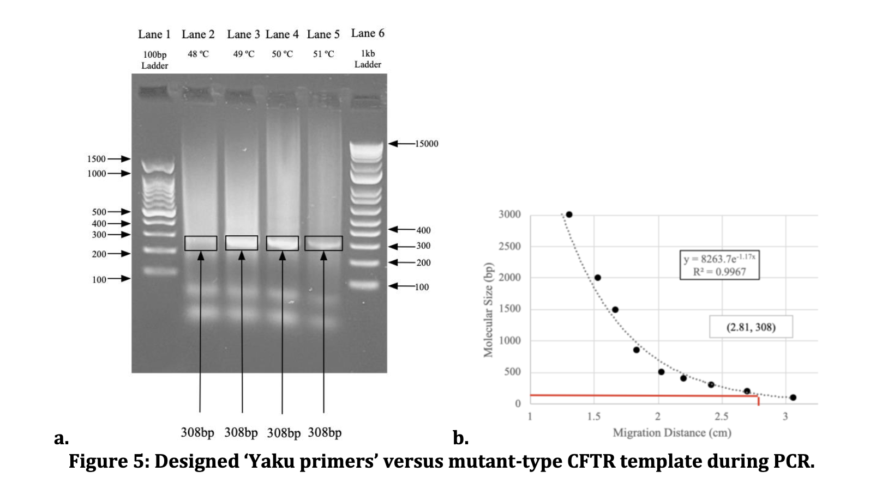

## Identification of the W1282X-CFTR SNP Mutation in CF Patient Cells via AS-PCR



<a href="https://scholarpublishing.org/journals/index.php/BJHR/article/view/7494
" target="_blank">Paper Link</a> 

The W1282X cystic fibrosis transmembrane conductance regulator (CFTR) gene mutation causes a severe form of cystic fibrosis which accounts for 1.2% of the CF worldwide. This single nucleotide polymorphism (SNP) CFTR mutation is located on exon 20, consisting of a change from guanine to adenine at the 3846th base pair, creating a premature stop codon. The purpose of this study was to develop a polymerase chain reaction (PCR) based diagnostic assay to identify the W1282X mutation using allele-specific primers. We hypothesized that the Yaku method, which introduces an additional intentional base pair mismatch, would reduce non-specific binding in allele-specific PCR (AS-PCR). To increase accuracy, we also employed a “nesting” amplification approach. A published reverse primer (PRP1) and a universal forward primer (UFP1) were designed to first amplify a 718 bp "template" region. After which, a published forward primer (PFP1) and Yaku reverse primers (RPMT1 and RPWT1) were paired to produce a 316 bp region diagnostic of the presence of either mutant W1282X-CFTR or wild-type CFTR in DNA samples. PCR products were analyzed via agarose gel electrophoresis, revealing expected bands of approximately 316 base pairs, supportive of successful W1282X detection with Yaku primers.

----


```{=html}
<div  style="margin: 30px; text-align: center;">
<a class="btn btn-primary" href="https://www.marvinschmitt.com/blog/website-tutorial-quarto/" role="button" target="_blank" style="padding: 15px 30px;">View the tutorial for this template (+ download link)</a>
</div>
```
